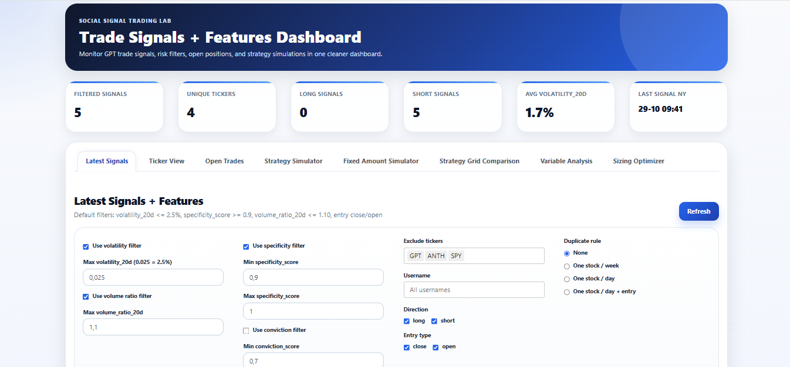
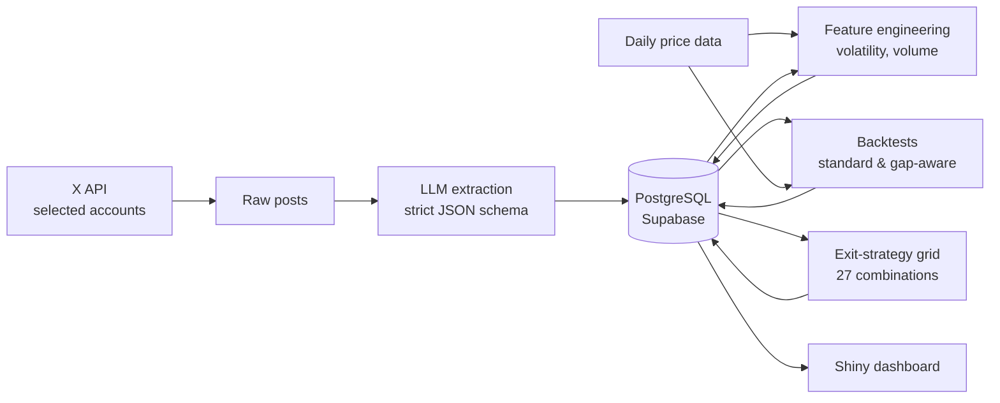

# LLM Social Signal Pipeline

**An automated system that reads posts from market commentators on X, uses an LLM to turn unstructured opinions into structured trade signals, and tests every signal against real price data — all running unattended in the cloud and visualized in a live Shiny dashboard.**

📊 **Live dashboard:** [Trade Signals + Features Dashboard](https://tt9o8f-jos0-pe0a.shinyapps.io/app_winter/)

---

## The problem

Investors and analysts share thousands of opinions on X every day, but they are written as free text: sarcasm, threads, vague hints, and the occasional specific, evidence-backed call. Following them manually is impossible, and nobody knows whose calls actually work. This project answers two questions automatically:

1. **What exactly is each account recommending?** (ticker, direction, time horizon, how specific and evidence-based it is)
2. **Would acting on those recommendations have made money?**

## What it does

Twice every market day (before the open and before the close, New York time):

1. **Ingests** new posts from a configurable list of accounts through the X API.
2. **Extracts signals with an LLM.** Each post is converted into structured JSON: ticker, long/short, horizon, conviction, specificity and evidence scores, evidence type (sales data, alternative data, news…) and a supporting snippet. Posts without a tradable call are discarded.
3. **Adds market features** to each signal from daily price data: 5- and 20-day volatility, volume ratios and related indicators.
4. **Backtests every signal** with a take-profit / stop-loss strategy (currently +10% / −5%), including a gap-aware version that accounts for overnight price jumps, and tracks open positions until they close.
5. **Runs an exit-strategy grid** (27 combinations of targets, stops and holding periods) to compare rules across all signals.
6. **Stores everything** in a PostgreSQL database, processing only new or changed rows.

The Shiny dashboard reads from the same database for monitoring, filtering and strategy simulation.

## Architecture

## Dashboard

| Tab | Purpose |
|---|---|
| Latest Signals | Newest signals with features and filters (volatility, specificity, conviction, account, direction) |
| Ticker View | All signals and outcomes for one ticker |
| Open Trades | Positions still active under the current strategy |
| Strategy Simulator / Fixed Amount Simulator | Simulated portfolio results under chosen filters |
| Strategy Grid Comparison | Results across exit-rule combinations |
| Variable Analysis | Which signal features relate to better outcomes |
| Sizing Optimizer | Position-sizing scenarios |

## Results

**Setup.** Every signal from June 2025 to November 2026 (about 14,600 trades with price data) was scored with one fixed model, prompt and temperature, then backtested with the same rules: $1,000 per signal; +10% take-profit and −5% stop-loss, with one third of the position kept as a runner that exits below its 10-day moving average (20-day lockup). Signals are filtered for 20-day volatility ≤ 2.5% and 20-day volume ratio ≤ 1.1; completed trades only.

The filters and exit rules were chosen on data up to September 20, 2026, when the scoring setup was frozen. Everything after that date is a **true out-of-sample test**.

**In-sample (June 2025 – September 20, 2026):** only the most specific posts stood out.

| Specificity score | Trades | Profitable | Avg return per trade | Median |
|---|---|---|---|---|
| below 0.50 | 1,190 | 44% | +0.4% | −1.7% |
| 0.50 – 0.79 | 1,267 | 48% | +0.9% | −0.5% |
| 0.80 – 0.89 | 102 | 41% | +0.4% | −2.3% |
| **0.90 and above** | **195** | **59%** | **+3.4%** | **+2.9%** |

**Over time (long signals):** the edge disappeared from July 2026, and the out-of-sample period confirms it.

| Period | 0.90+ trades | Profitable | Avg return | Other signals, avg return |
|---|---|---|---|---|
| Jun 2025 – Jun 2026 | 150 | 67% | **+4.7%** | +1.1% |
| Jul – Sep 20, 2026 | 18 | 22% | −2.6% | −0.1% |
| **Sep 21 – Nov 2026 (out-of-sample)** | 14 | 21% | **−3.0%** | −0.8% |

**Key findings**
- For the first year, the LLM's specificity score separated useful signals from noise: posts scored 0.90+ returned about four times as much per trade as the rest.
- Long signals carried the results; short signals averaged about zero.
- **Since July 2026 the edge has reversed.** High-specificity longs now do worse than low-specificity ones. All six accounts with recent 0.90+ signals turned negative, so it is not one source going wrong.
- Most recent losses hit the −5% stop within days, often in correlated groups: consumer and retail names in July, and large AI and semiconductor stocks (NVDA, GOOGL, AVGO, ASML, MSFT) in October. That points to sector moves rather than independent bad calls.
- **The stop is not the problem.** Wider stops (8–15%), no stop, and fixed 10/20/40-day holds were tested on the same trades. For 0.90+ longs they barely changed the good year (+4.7% to +5.6% per trade) but made the out-of-sample losses larger: −8.4% per trade with no stop and −11.8% with a 20-day hold, against −3.0% with the −5% stop. Only 2 of 25 recent stopped-out trades would have recovered within 20 days; several fell more than 20% (NVDA, GOOGL, FFIV).
- Signals scored 0.80–0.89 behave differently: their longs improve with more room (+1.0% per trade with the −5% stop, +2.1% with no stop over 78 trades). This was found after looking at the data, so it is a hypothesis to track, not a rule.

**What this means.** The rule is not reliable as it stands and should not be traded with real money. It stays in the dashboard as a paper-tracked signal while three explanations are tested: a market-regime change, a stop that is too tight for more volatile markets, and limits on correlated trades (per company and per sector).

**Limitations**
- The out-of-sample sample is small (14 long trades at 0.90+), but the July–November results all point the same way.
- Results exclude commissions, slippage and short-borrow costs.

## Scoring consistency

In April–May 2026 a rewrite of the signal prompt changed the score distribution (example values in the prompt anchored scores, and conversations without a signal were re-sent to the model on every run). The full history was therefore **re-scored in one pass** with a single model (gpt-4o-2024-11-20), prompt and temperature 0, with every row tagged by scoring version and a fingerprint of the prompt. Live scoring now uses the same setup and scores each conversation exactly once. In November 2026 the historical and live scores produced the same share of 0.90+ signals (4–5%), which confirms the two are consistent.

## Tech stack

| Layer | Tools |
|---|---|
| Language | R (DBI, RPostgres, dplyr, httr2/curl, jsonlite) |
| Data | X API, daily stock price data (cached between runs) |
| AI | OpenAI API with structured JSON output (historical re-score: gpt-4o-2024-11-20, temperature 0) |
| Storage | PostgreSQL on Supabase |
| Automation | GitHub Actions on a market-hours schedule, with manual run options |
| Front end | Shiny, deployed on shinyapps.io |

## Pipeline scripts

| Script | Role |
|---|---|
| `twitter_ingest.R` | Pull new posts from the configured accounts |
| `generate_tweet_signals.R` | LLM extraction of structured trade signals |
| `refresh_trade_signal_features.R` | Price-based features for each signal |
| `refresh_backtest_results.R` | Standard take-profit / stop-loss backtest |
| `refresh_backtest_results_gap_aware.R` | Backtest accounting for overnight gaps |
| `refresh_exit_grid_results_raw.R` | Exit-strategy grid across all signals |
| `backtest_tp10_sl5_incremental.R` | Earlier standalone version of the +10% / −5% backtest (not run by the workflow) |
| `.github/workflows/` | Scheduling, configuration and manual-run inputs |

## Configuration

Accounts, strategy parameters (target, stop, lookback windows) and table names are set as workflow environment variables, so the same pipeline can track different accounts or strategies without code changes.

**Required secrets** (GitHub Actions, never stored in code): X API bearer token, OpenAI API key, and Supabase connection details.

## Design choices

- **Incremental by default.** Each run processes only new signals and open trades; full rebuilds are an explicit manual option.
- **Strict LLM output.** A fixed JSON schema with allowed values (long/short; short/mid/long horizon; 0–1 scores) keeps extracted data consistent and queryable.
- **Evidence-aware.** Signals are scored for specificity and evidence, so vague opinions can be filtered out instead of traded.
- **Realistic testing.** The gap-aware backtest avoids the common mistake of assuming stops always fill at their exact price.

## Adapting it

The same architecture works for any "unstructured text → structured data → measured outcome" problem, for example: competitor mentions, product complaints, pricing changes, or analyst opinions from news, forums or reviews.

## Disclaimer

This is a research project. Signals and backtests are not investment advice, and past results do not predict future performance.

## Author

**José Peña** — data scientist (R, Shiny, LLM pipelines), M.A. in Public Policy, Pontificia Universidad Católica de Chile.
Available for data automation, LLM extraction and dashboard projects: [Upwork profile](https://www.upwork.com/freelancers/~01250f8b7932eeb75d)
